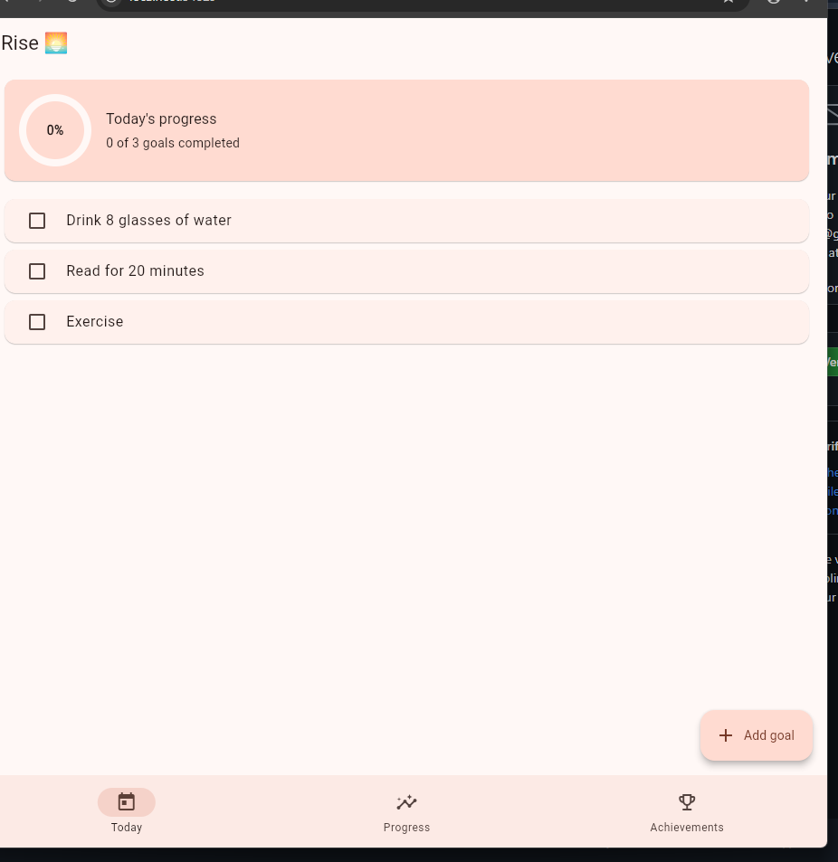
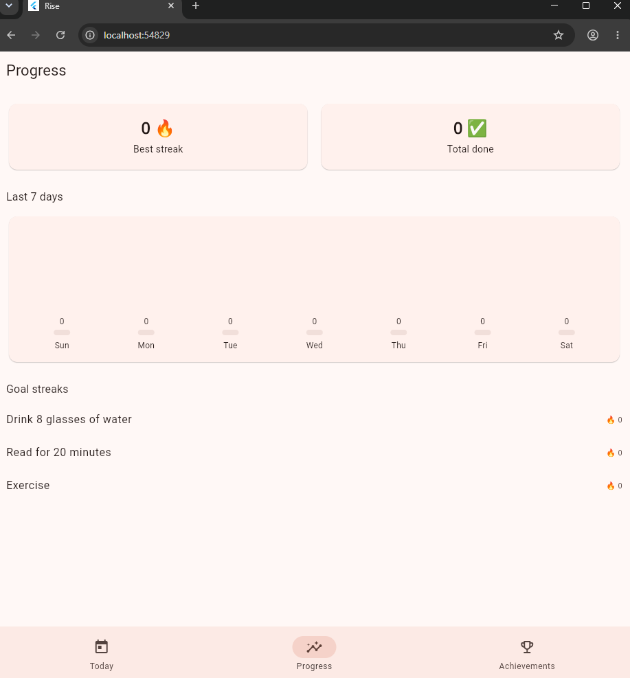

Rise 🌅 — Goal Tracker
Rise is a simple, clean goal-tracking application built with Flutter. It helps users keep track of daily habits, monitor progress, build streaks, and stay motivated by unlocking achievements.
Screenshots
Today
View your daily goals, mark goals as completed, check your daily progress, and add new goals.

Progress
Track your best streak, total completed goals, activity over the last seven days, and individual goal streaks.

Achievements
Stay motivated by unlocking achievements as you create goals, complete them, and build consistent habits.

Features
Daily goal tracking: View and check off goals for today.
Add goals: Create personal goals from the Today screen.
Daily progress: See the number and percentage of goals completed.
Progress dashboard: View your best streak and total completed goals.
Seven-day overview: Review daily completion counts for the last seven days.
Goal streaks: Track consecutive days of progress for each goal.
Achievements: Unlock milestones such as First Step, Getting Started, Perfect Day, 3-Day Streak, 7-Day Streak, and Consistent.
Bottom navigation: Switch between Today, Progress, and Achievements.
Simple interface: A soft peach colour palette and a clean layout.
Built With
Flutter — cross-platform UI toolkit.
Dart — programming language used by Flutter.
Provider — state management, if used in the current project.
Getting Started
Prerequisites
Flutter SDK
Dart SDK (included with Flutter)
Visual Studio Code or Android Studio
A supported browser, emulator, or device
Installation
Clone the repository:
```bash
   git clone <YOUR_REPOSITORY_URL>
   ```
Open the project directory:
```bash
   cd goal_tracker
   ```
Install dependencies:
```bash
   flutter pub get
   ```
Run the app:
```bash
   flutter run
   ```
To run the web version in Chrome, if Flutter web support is enabled:
```bash
   flutter run -d chrome
   ```
How to Use
Open the Today screen.
Mark a goal as completed by tapping its checkbox.
Select Add goal to create a new goal.
Open Progress to review completed goals, recent activity, and streaks.
Open Achievements to see unlocked milestones and goals for future achievements.
Project Structure
A typical Flutter project structure includes:
```text
goal_tracker/
├── lib/                  # Application source code
├── test/                 # Automated tests
├── android/              # Android platform files
├── ios/                  # iOS platform files
├── web/                  # Web platform files
├── windows/              # Windows platform files
├── pubspec.yaml           # Project metadata and dependencies
└── README.md              # Project documentation
```
Future Improvements
Save goals and progress across app restarts
Add reminders for daily goals
Add more progress charts and insights
Support editing and organising goals
Add data backup or cloud synchronisation
Author
Built as a Flutter learning project to practise UI development, state management, and building a goal-tracking application.